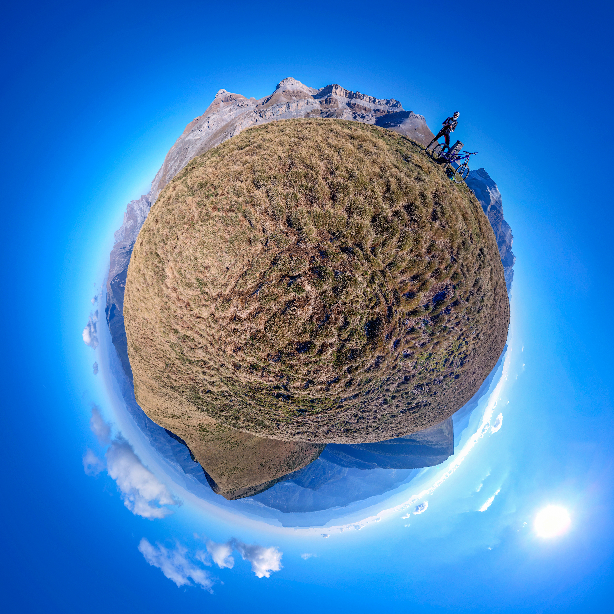
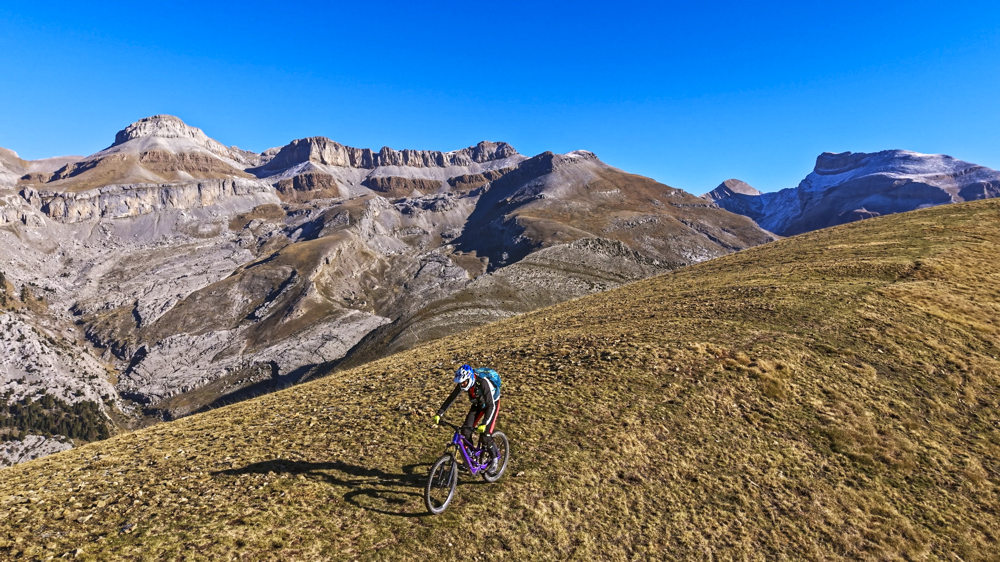
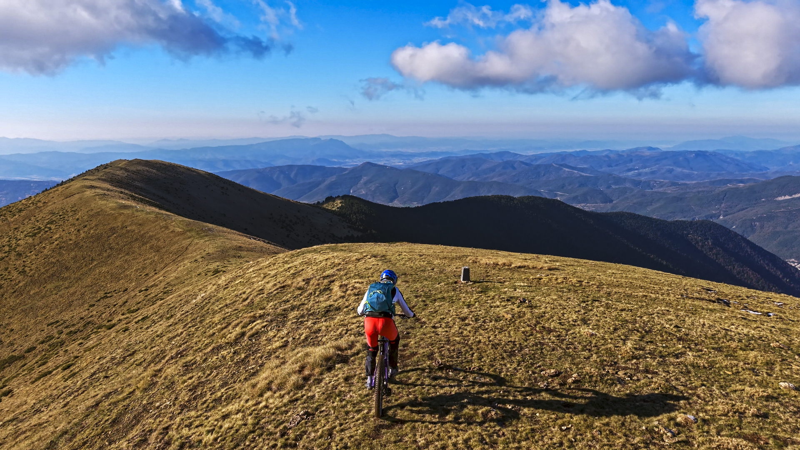
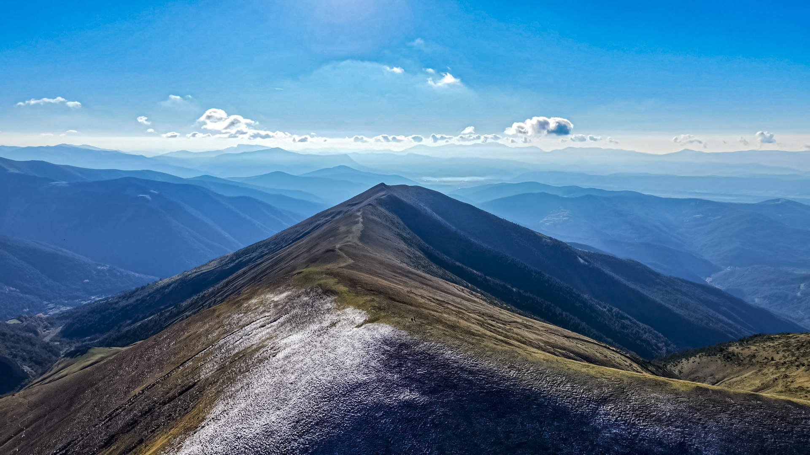
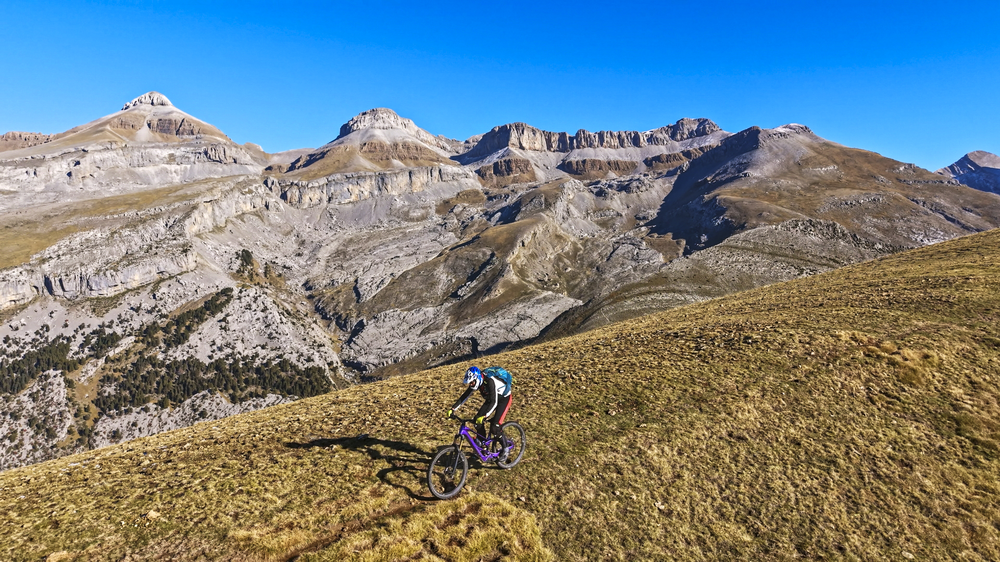

## La idea
Con estos maravillosos días otoñales, frescos y con una atmósfera totalmente cristalina y calmada, uno de los objetivos cantados era ir a grabar con el dron unas tomas aéreas del cordal que une los picos de Bacún Norte y Sur, con el impresionante Collarada de fondo...
Además AlbertoEpic tenía curiosidad por probar qué tal era esa vuelta con su nueva e-bike!
Y una vez cumplida la misión, como se sentía culpable de lo poco que se había cansado, decidió volver a subir para realizar los descensos de los senderos de **Caparruso** y **Sendero d'As Foyas**. Una apuesta segura siempre, estos senderos que cuentan con la garantía del sello de Calidad de la **[Familia Freeridez](https://www.wikiloc.com/wikiloc/user.do?id=1110720)**! Enormemente agradecido a su gran labor...

## La Ruta
A continuación tienes la ruta de la jornada:

<iframe class="embedly-embed" frameborder="0" scrolling="no" allowfullscreen src="https://cdn.embedly.com/widgets/media.html?src=https://www.relive.com/view/vLqeYjg98dq/widget?r=embed-site&url=https://www.relive.com/view/vLqeYjg98dq?r=embed-site&image=https://www.relive.com/view/vLqeYjg98dq/png?x-ref=embed-site&key=f1631a41cb254ca5b035dc5747a5bd75&type=text/html&schema=relive" width="1024" height="801" style="position: absolute;top: 0;left: 0;width: 100%;height: 100%;"></iframe>

## El Vídeo
Tras la jornada, toca regresar a los Headquarters de Producciones SQLP para entregar todo el material gráfico del dron, con el que producir este mini-reportaje de la travesía entre las puntas Norte y Sur de los Bacunes:

## El Miniplaneta

Y ya puestos a jugar, te contamos que hemos ampliado todo el ecosistema de SQLP con un nuevo miniplaneta en nuestro catálogo y web dedicada, **[miniplanetas.soloquedalopeor.com](https://miniplanetas.soloquedalopeor.com)**, puedes **[ver aquí el planeta Bacún](https://miniplanetas.soloquedalopeor.com/planetas/planeta-bacun/)**.

## La Foto Esférica
Puedes estudiar un poco de geografía gracias a la foto esférica con cimas etiquetadas en nuestra web dedicada **[pano360.soloquedalopeor.com](https://pano360.soloquedalopeor.com/)** desde la **[cima del pico Bacún Norte](https://pano360.soloquedalopeor.com/productos/bacun-norte/)**.

## Las Fotos

AlbertoEpic en el tramo inicial, muy cerca todavía de la cima del Bacún Norte.

Todo el cordal recorrido en el descenso: hasta el Bacún Sur y posteriormente por el bosque...

El otro atractivo cordal más al este, hacia el pico de La Lera.

Con el Collarada y Collaradeta al fondo.

## El Track
Si te ha gustado la ruta, puedes descargarte el track de la base de datos de SQLP:
