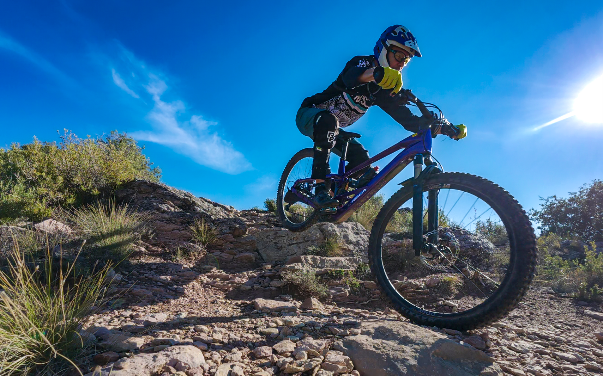
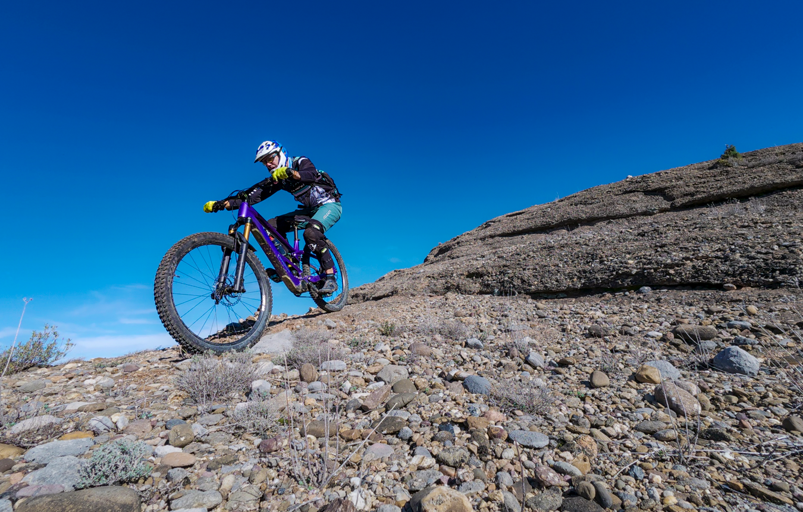

## La idea
Por fin, después de mucho tiempo con cielos totalmente azules, hemos pasado una racha de lluvias. Todos los caminos antes polvorientos ahora están cubiertos de barro. Siempre le queda el comodín de la bici de carretera, pero claro, nuestro especialista AlbertoEpic es un ser silvestre con alergia al asfalto, así que le toca pensar: ¿dónde sacar de paseo a Gertru, su nueva EMTB, sin mancharla demasiado?
La respuesta no admite discusión: en época de lluvias, ALQUÉZAR!!!
Así que replica la ya usada táctica con la bici a pilas, reunir en una única mañana dos o tres rutas normales de 'bici acústica'...

## El Vídeo
A continuación puedes ver el vídeo de la actividad:

## Las Fotos

En la zona de las Balsas de Basacol. Descenso desde Quizáns.

En el cordal del Lumos.

## El Track
Si te apetece realizar la misma combinación de senderos, puedes ver y descargarte el track en este mapa:
